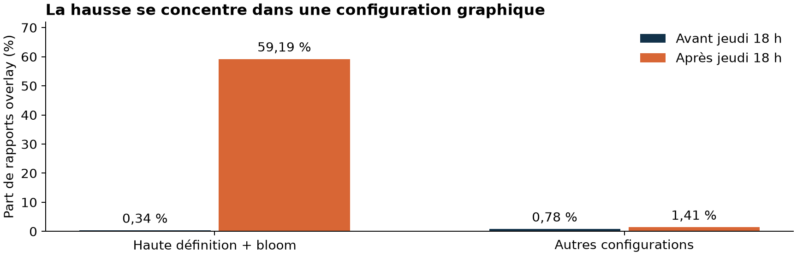
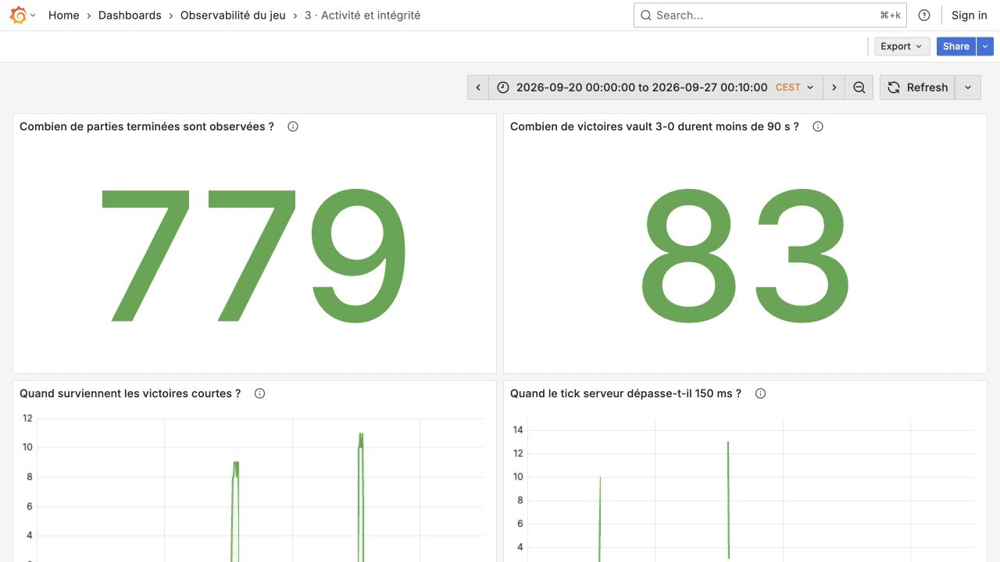

# Observabilité d'un jeu multijoueur
## UE03 · 8 octobre 2026

Le studio cherche la cause des saccades du jeudi soir et veut savoir si certains clients abusent du jeu. L'analyse porte sur l'export fourni. Grafana montre les données historiques et l'état actuel du service. Les heures du rapport sont en Europe/Paris.

## 1. Logs et métriques

Node.js écrit les logs. Alloy les collecte dans Loki. Prometheus interroge /metrics. Grafana affiche les deux sources. L'export historique est nettoyé puis importé dans Loki. Les requêtes du dépôt permettent de vérifier les chiffres.

Les métriques donnent les volumes, les erreurs et les durées. Les logs permettent de retrouver une partie ou un client précis. Les compteurs actuels suivent les nouvelles données. L'archive de septembre est consultée séparément.

| Métrique | Type | Labels et usage |
| --- | --- | --- |
| game_http_requests_total | Counter | method, route, status : débit et erreurs |
| game_http_duration_seconds | Histogram | method, route : latence HTTP et p95 |
| game_active | Gauge | Sans label : parties en cours |
| game_reports_total | Counter | cause, build, origin : rapports reçus |
| game_frame_seconds | Histogram | cause, build : durées d'image |
| game_completed_total | Counter | map : fins de partie |
| game_integrity_signals_total | Counter | kind, origin : anomalies |
| game_process_* | Plusieurs types | État du processus Node |

Counter est un compteur. Gauge suit une valeur qui peut monter ou descendre. Histogram regroupe les durées pour voir leur répartition. Le p95 est le temps sous lequel passent 95 % des requêtes. Ici, il mesure la réponse de l'API, pas la fluidité du jeu.

Les identifiants clients restent dans les logs. Loki les classe avec quelques étiquettes : job, source, event et level pour le direct. Dans Prometheus, les versions du jeu et les cartes inconnues sont regroupées dans other. Cela évite de créer trop de groupes de mesure.

Trois règles enregistrent le nombre de requêtes par seconde, la part d'erreurs serveur et la part de problèmes overlay sur cinq minutes. Cette dernière exclut les rapports incohérents, les onglets masqués, la compilation graphique et les cas inconnus. Elle ne se compare donc pas directement aux chiffres de l'archive. Les règles sont dans observability/prometheus/rules.yml.

<!-- page -->
# 2. Qualité de l'export

Le fichier mélange des en-têtes et des données sur plusieurs lignes. Le script les lit par blocs, ramène les dates à une heure de référence commune (UTC) et retire les doublons exacts. Aucun bloc JSON invalide ni conflit d'identifiant n'est relevé.

| Contrôle | Résultat | Preuve |
| --- | --- | --- |
| Blocs bruts | 2 944 : 2 148 rapports, 796 fins | Bilan + Q01 |
| Doublons retirés | 55 : 38 rapports, 17 fins | Q02 + bilan |
| Événements uniques | 2 889 : 2 110 rapports, 779 fins | Q01 |
| Rapports v1 / v2 | 2 085 / 25 | Q12 |
| GPU non mesuré | 882 valeurs gpuRenderMs null | Q12 |
| Somme des durées supérieure à la durée de l'image + 10 ms | 70 rapports | Q21 |
| Création après événement / capacité dépassée | 0 / 0 | Q13 |
| Rapport après une fin connue | 0 | Q28 |
| Parties citées sans fin correspondante | 72, dont 70 liées aux rapports incohérents | Q15, Q27 |
| Intervalles sans événement > 30 min | 60 | Q11 |

Les références Q01 à Q34 correspondent aux requêtes de analysis/queries.sql dans le dépôt. analysis/results.json contient leurs résultats. npm run analyze permet de les recalculer.

### Pièges traités

Les dates utilisent le format américain et le fuseau Paris. Le corpus va du 20 septembre à 00:31:37 au 27 à 00:04:13. Les six événements du 27 local sont conservés malgré le nom du fichier (Q22).

L'ordre d'origine compte 2 remontées, 2 871 descentes et 15 égalités entre événements uniques consécutifs. Les événements sont remis dans l'ordre, sans changer l'ordre des égalités (Q26). La version 2 du format change l'emplacement du temps réseau et ajoute une mesure du calcul physique. Les valeurs absentes ne sont pas remplacées par zéro.

Le plus grand trou dure 8 111 secondes. Les écarts entre les numéros de rapports représentent 9 025 numéros pour le client incohérent et 13 pour six autres clients. Cela ne suffit pas à prouver une perte de collecte (Q11, Q14).

### Limite constatée

Au premier lancement, Loki retrouvait 2 065 rapports. Une commande manuelle (POST /flush) a rendu les 2 110 visibles, sans refaire l'import. Les 779 fins étaient déjà présentes. Cette solution fonctionne, mais le premier lancement n'est pas encore entièrement automatique. La requête et les résultats sont dans evidence/loki-backfill-diagnostic.md. Le contrôle des données déjà chargées est limité à 10 000 événements.

<!-- page -->
# 3. Classement et alertes

Le script d'import et le service classent les rapports avec les mêmes règles. La première règle qui correspond est retenue. Ce classement décrit les mesures ; il ne suffit pas à prouver la cause.

| Classe | Signature | Rapports |
| --- | --- | --- |
| inconsistent | Somme des durées trop grande, de plus de 10 ms, ou durée négative | 70 |
| background | Onglet masqué et attente du navigateur supérieure à 500 ms | 158 |
| shader | Première capture, au moins 20 programmes graphiques créés | 459 |
| overlay | Affichage des éléments superposés à l'image : au moins 200 ms | 262 |
| server_tick | Retard serveur et aller-retour réseau : au moins 150 ms chacun | 7 |
| network | Rapport signalé comme réseau, aller-retour d'au moins 150 ms | 85 |
| world | Calcul des éléments du jeu : au moins 50 ms | 20 |
| render_other | Durées exploitables, sans autre signature | 1 049 |
| unknown | Données insuffisantes | 0 |

Total : 2 110 rapports (Q03). Le seuil overlay de 200 ms sépare les groupes de l'export : les cas retenus commencent à 222,8 ms, les autres ne dépassent pas 3 ms (Q30). Les rapports incohérents restent dans les logs, mais sortent des comparaisons de durées.

### Règles de détection

**ServiceUnavailable :** service injoignable pendant 1 min. Un contrôle raté ne suffit pas ; une panne très brève peut être manquée.

**ApiErrors :** plus de 5 % d'erreurs serveur et plus de 1 requête/s pendant 2 min. Cela évite les alertes sur quelques requêtes seulement. Une erreur acceptée avec un code HTTP 202 reste invisible pour cette règle.

**OverlayRegression :** plus de 15 % de rapports overlay et plus de 20 rapports sur 5 min, pendant 2 min. Ces minima évitent les cas isolés. Une scène coûteuse peut déclencher l'alerte ; un client silencieux peut lui échapper.

**InconsistentTelemetry :** au moins 3 signaux sur 10 min, pendant 1 min. La répétition est exigée. Une erreur de mesure peut ressembler à une falsification.

**ServerTickDegraded :** au moins 3 rapports sur 5 min, pendant 1 min. Trois rapports ne signifient pas trois clients. Le libellé « plusieurs clients » reste à corriger.

**RepeatedShortWins :** au moins 5 victoires courtes sur 10 min, pendant 1 min. Des tests peuvent déclencher la règle ; un abus lent peut passer sous le seuil. Ce seuil reste à ajuster. La vitesse de simulation est prise en compte.

Les tests vérifient des cas qui doivent déclencher une alerte et des cas qui ne doivent pas en déclencher. Ils ne mesurent pas la précision en production. Les alertes suivent les nouvelles données. Elles ne rejouent pas l'archive et ne bannissent aucun joueur.

<!-- page -->
# 4. Ce que montrent les données

### Saccades du jeudi

La comparaison porte sur les rapports cohérents avant et après jeudi 18 h. Le groupe étudié utilise une largeur d'au moins 2 560 pixels et l'effet lumineux bloom activé.

**PROUVÉ :** ce groupe passe de 1/298 rapports overlay à 248/419. Les autres configurations passent de 7/897 à 6/426 (Q16, Q24). Les 248 rapports concernent **39 identifiants clients et 52 parties**. Leur durée d'image moyenne est de 478,3 ms, dont 423,7 ms pour renderOverlay (Q31).

Le premier overlay cohérent observé sur beta-20260924-3 date du jeudi à 20:16:26. Les pics restent présents sur les versions suivantes (Q23). L'aller-retour réseau moyen des 262 rapports overlay est de 35,1 ms. Aucun retard serveur n'atteint 150 ms (Q19).

**DÉDUIT :** le problème vient probablement de l'affichage dans le navigateur. Le vrai client n'est pas fourni, donc le code responsable reste inconnu. Ces rapports ne donnent pas le taux parmi tous les joueurs.

### Parties et clients suspects

83 victoires vault 3-0 durent de 54,35 à 74,43 s, contre 351 à 811,8 s pour les 15 autres victoires comparables. Deux épisodes ressortent : 45 parties le 23 septembre et 38 le 25, la nuit (Q18, Q33). Le rapprochement des données associe 14 parties à trois identifiants clients ; les 69 autres n'ont pas de rapport correspondant (Q25, Q34). Une accumulation automatisée de victoires est plausible, sans preuve d'intention.

Le client 5e1f0c7a envoie 70 rapports dont la somme des durées dépasse la durée de l'image de plus de 10 ms, du 24 au 26 septembre. Aucun de leurs 70 identifiants de serveurs n'a de fin correspondante (Q10, Q21, Q27). Une falsification ou une erreur de mesure peut expliquer ces incohérences.

Enfin, 25 événements montrent un retard serveur d'au moins 150 ms sur 9 serveurs, surtout les 21 et 23 vers 03 h (Q07, Q32). Une tâche planifiée est une piste **SUPPOSÉE** à vérifier dans les journaux d'exploitation.

<!-- page -->
# 5. Rapport d'incident

### Chronologie

Le 20 septembre, des pics isolés existent déjà. Les 21 et 23 vers 03 h, le serveur prend du retard. Le 23 à 01:14 commence le premier épisode de victoires courtes.

Le jeudi 24 à 09:35 apparaissent les mesures incohérentes. À 20:16, le premier overlay cohérent de la version beta-20260924-3 est observé dans le groupe haute définition + bloom. Le 25 à 00:44 commence le second épisode de victoires courtes. Le 26, les pics overlay sont encore présents.

### Réponse à la direction

**Pourquoi les saccades et qui est touché ?** Les mesures indiquent un problème probable d'affichage des éléments superposés (overlay) dans les versions récentes. Il touche surtout la haute définition avec l'effet lumineux bloom. Le groupe identifié représente 248 rapports, 39 identifiants clients et 52 parties après jeudi 18 h. La résolution n'est pas démontrée.

**Est-ce que quelqu'un abuse du jeu ?** Les 83 parties très courtes et les 70 rapports incohérents justifient une enquête. Ils ne suffisent pas à prouver une triche. Les requêtes de la partie 4 et les captures Grafana permettent de retrouver les observations.

### Actions correctives proposées

Comparer l'ancienne et la nouvelle version sur la même scène et le même matériel. Changer un seul réglage par essai : bloom ou largeur d'affichage. Selon le résultat, envisager un retour à la version précédente ou une désactivation de l'effet.

Vérifier les replays et les scores serveur des parties courtes. Comparer les rapports incohérents à une trace navigateur indépendante. Comparer les retards serveur aux horaires des tâches planifiées.

### Prévention

Suivre les changements du format des rapports. Relier chaque rapport à une session connectée et à l'heure du serveur. Mesurer aussi l'activité des joueurs et recevoir des signaux réguliers pour repérer les données manquantes. Ces actions sont proposées, pas encore mises en place.

<!-- page -->
# 6. Dashboards et contrôles

Grafana contient trois dashboards : santé du service, performance côté joueur, activité et intégrité. Chaque panneau pose une question. Le premier suit le direct ; les deux autres montrent l'archive.

Les 18 panneaux ont renvoyé des données le 8 octobre, après la commande manuelle dans Loki. Le ZIP contient les trois exports JSON et cinq captures. Le dépôt conserve les configurations et les requêtes.

Compose lance le service, le générateur de charge et les outils d'observabilité. Le Dockerfile utilise plusieurs étapes et le service tourne sans droits administrateur. Le pipeline vérifie le style du code, les tests et les configurations. Il construit l'image, cherche les vulnérabilités avec Trivy puis la publie dans le registre GitHub avec l'identifiant du commit.

Les 22 tests passent. Le scan du projet ne signale aucune vulnérabilité critique à la date du contrôle. Un test volontairement faux et une image témoin vulnérable ont chacun bloqué la publication. Les journaux et liens sont dans evidence/nouvelle-ci/ et docs/publication.md.

La vidéo du ZIP montre le projet en fonctionnement. Elle dure 2 min 26 s, avec des commentaires à l'écran et sans audio.

Pour vérifier les chiffres, lancer npm run analyze. Les résultats et leurs requêtes sont dans analysis/ sur GitHub. Les limites et les étapes de reproduction sont dans docs/reproduction.md.
